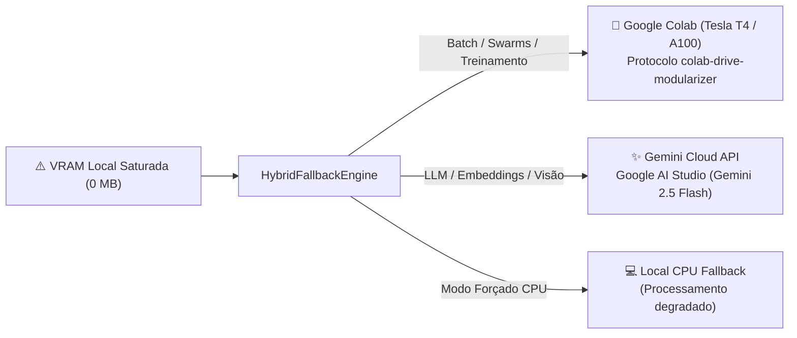

# Motor de Fallback Híbrido — GPULivre (Colab & Gemini)

O **Hybrid Fallback Engine** (`gpulivre.core.hybrid_fallback`) elimina o risco de inanição ou travamento (*Out Of Memory*) de agentes de IA quando o hardware local atinge 100% de ocupação.

---

## 1. Roteamento por Tipo de Carga

---

## 2. Destinos e Protocolos

### A. Google Colab (GPU Remota Gratuita)
- **Protocolo:** Baseado na skill `colab-drive-modularizer`.
- **Uso:** Simulações multi-agente MiroFish, backtesting massivo de estratégias quantitativas e fine-tuning.
- **Vantagem:** Utiliza instâncias com GPUs Tesla T4 (16 GB VRAM) ou A100 sem custo financeiro para tarefas não interativas de segundo plano.

### B. Gemini Cloud API (Google AI Studio)
- **SDK:** `google-genai` / `ai_studio_client`.
- **Uso:** Tarefas cognitivas, classificação de sentimento de mercado, extração de relatórios e embeddings vetoriais.
- **Vantagem:** Latência ultrabaixa, janela de contexto de 1 milhão de tokens e custo zero de computação local.

---

## 3. Controle pelo Usuário

O usuário pode definir suas preferências em `~/.antigravity/gpulivre_user_config.json`:
- `"preferred_fallback": "auto"` (Padrão: Swarms vão para Colab; LLM vai para Gemini).
- `"preferred_fallback": "colab"` (Força sempre Google Colab).
- `"preferred_fallback": "gemini"` (Força sempre Gemini Cloud).
- `"hybrid_fallback_enabled": false` (Desativa desvio remoto; tarefas que estourarem a VRAM são rejeitadas localmente com mensagem clara).
